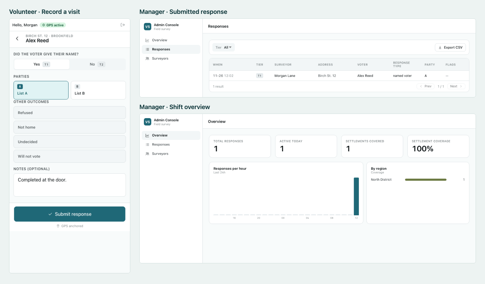

# Field Survey Desk

A volunteer opens an assigned street, chooses a household member and records the visit. The field manager can see who submitted the response, which door they visited and which answer they recorded.

[](docs/results.png)

[Volunteer route](docs/route.png) · [Completed survey form](docs/survey.png) · [Manager’s response table](docs/results.png) · [Shift overview](docs/overview.png)

## Run the app and API

With Git access to this private repository and Docker Compose installed, run:

```sh
git clone https://github.com/Dror-Bengal/field-survey-desk.git
cd field-survey-desk
docker compose up -d --build --wait
```

| Role | Open on this computer | Demo email |
| --- | --- | --- |
| Volunteer | [Field app](http://localhost:18798/surveyor) | `volunteer@example.test` |
| Manager | [Management console](http://localhost:18798/admin) | `manager@example.test` |

Both local demo accounts use `FieldDemo2026!`. Open the two roles in separate browser profiles or use a private window for the second role.

1. **Volunteer.** Choose **Brookfield → Browse → Birch → Birch St. 12 → Alex Reed**. Choose **List A**, add a note and press **Submit response**. The original app supports visits with GPS and lets the volunteer continue without it. If the device is far from the sample district, review the distance prompt and press **Submit anyway**.
2. **Manager.** Open **Responses**. The new row shows **Morgan Lane**, **Birch St. 12**, **Alex Reed** and **A**. Open **Overview** to see the response in the shift total. If the table was already open, reopen it or reload to fetch the latest records.

## What runs locally

- `app/` contains the original React volunteer screens and manager console, with English labels and a fictional district. The sample includes six addresses and ten fictional residents. The edition initially contains zero completed surveys.
- `api/` contains the original Hono and MongoDB API for login roles, assignments, sessions, households, survey responses and reporting. Each submission receives a response ID. The manager reads the same stored record.
- `identity/` runs the Firebase Authentication emulator. The server checks identity and role for each protected route. All three services run locally and only the app port is exposed on loopback. No cloud account or API key is required.
- MongoDB stores responses in the named `surveys` volume. `docker compose down` followed by `docker compose up -d --wait` preserves the records. To use a different port, set `SURVEY_PORT` when starting Compose.

## Verify a complete visit

From the repository root, with the app running:

```sh
python3 -m venv .venv
. .venv/bin/activate
pip install -r tests/requirements.txt
python -m playwright install chromium
python tests/visit.py --clean
```

The browser test signs in with separate volunteer and manager sessions, selects a resident, submits an answer and checks the dashboard count. It matches the server-issued ID and the volunteer’s note against the manager’s API response, then checks the corresponding **visible table row**. The test uses simulated coordinates in the fictional district. It sends actual requests to the local services.

Use `--clean` on a fresh database. Omit it to record another test visit, or use `--verify-id ID` to check an existing visit after restarting without recording another. Add `--capture ./captures` to save screenshots from the run.
